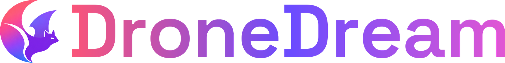

  

## 🚁 Product

DroneDream is a workspace for natural-language drone missions. It brings maps,
aircraft, model-assisted planning, PX4 and Gazebo simulation, tuning, Runtime
management, and flight evidence into one connected project.

## 🧭 Mission workflow

An operator describes the goal instead of writing a flight script. DroneDream
uses the selected map, aircraft, and project context to clarify missing facts,
prepare a reviewable plan, and preserve mission continuity through execution,
replanning, return, and landing. Model reasoning works alongside deterministic
flight and safety boundaries rather than replacing them.

## 🎛️ Software editions

One `main` branch produces Universal, SIM, LAB, FIELD, and AGENT, as well as the
public website. The five desktop editions share the same product source and are
separated only by their configuration, branding, capabilities, installation
identity, and update channel.

## 🗂️ Source layout

`apps` contains the desktop, web, and website applications; `server` contains
the API, worker, and database services; `runtime` contains the engine and WSL
installation lifecycle; `shared` contains brand assets and contracts; `release`
contains publication configuration; and `docs` and `tools` contain the maintained
guidance and development utilities.

## 🧠 Agent Core

The natural-language flight core is maintained in the
[DroneDream Agent Core](https://github.com/ChiZhang-805/DroneDream-Agent-Core)
repository and is staged into software releases through the product build
process.

## 🛠️ Development and release

Begin with the [local setup guide](docs/development/04-local-setup.md), then use
the [development and release guide](docs/development/development-and-release.md)
for validation, packaging, installation, and evidence requirements. GitHub
Actions is intentionally limited to `Check code`, `Deploy website`,
`Release Software`, and `Release runtime`.

## 📄 License

DroneDream is available under the [MIT License](LICENSE). Product, engineering,
release, privacy, and legal documentation is maintained in [`docs`](docs/README.md).
