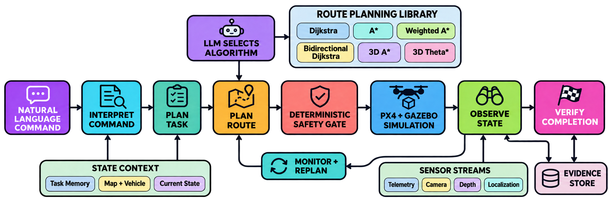
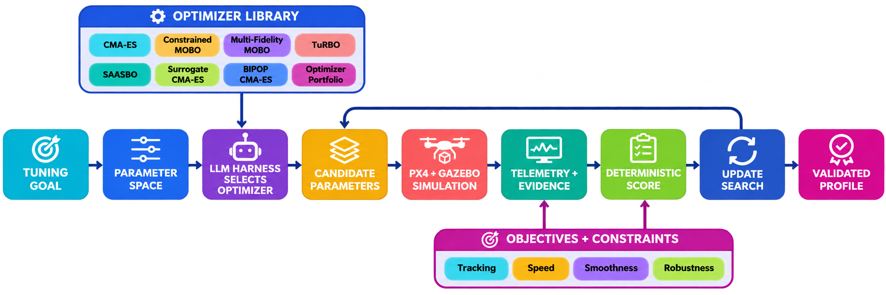

  

## Introduction

DroneDream is a unified workspace for natural-language drone missions and PX4 parameter tuning. Its five software editions share one product source while providing the maps, aircraft, Runtime, simulation, evidence, and operational capabilities appropriate to each environment.

## Flight Agent

The Flight Agent interprets a natural-language command, builds the task, and lets the LLM select one to four route-planning algorithms that are actually available for the current map, aircraft, geometry, risk, and time budget. Dijkstra, A*, Weighted A*, Bidirectional Dijkstra, 3D A*, and 3D Theta* produce candidates; deterministic clearance, collision, trajectory, and execution gates retain final veto authority before mandatory PX4 and Gazebo simulation or flight.

  

## Parameter Tuning

Parameter Tuning turns an objective and bounded PX4 parameter space into an evidence-driven search. The LLM Harness selects eligible optimizer tools, each candidate runs through PX4 and Gazebo, telemetry is scored against tracking, speed, smoothness, and robustness objectives, and the resulting evidence updates the search until a profile satisfies the validation contract.

  

