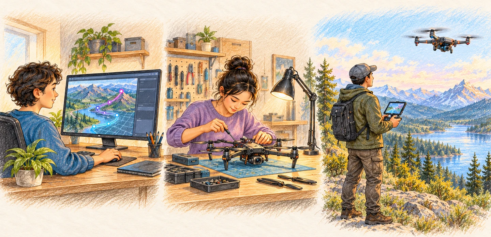
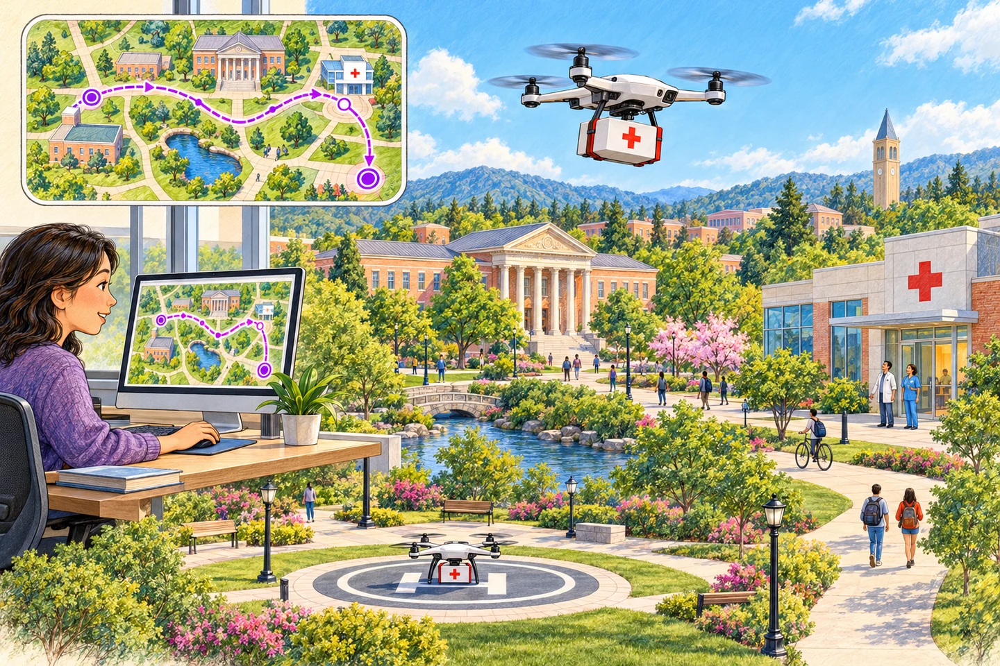
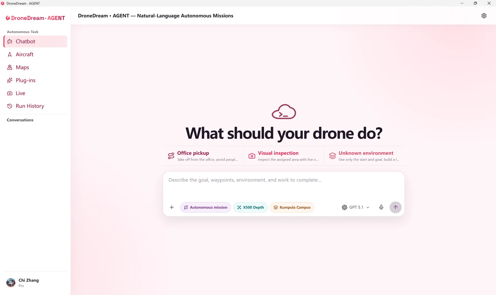
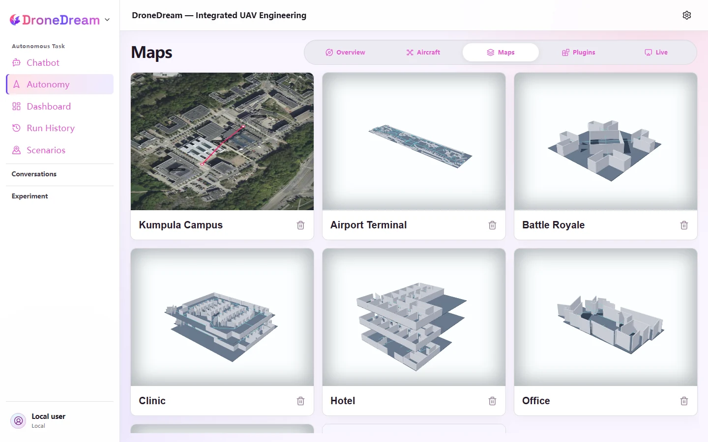
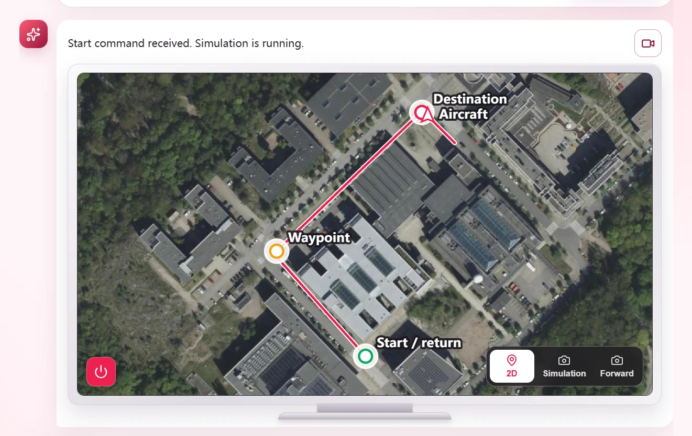
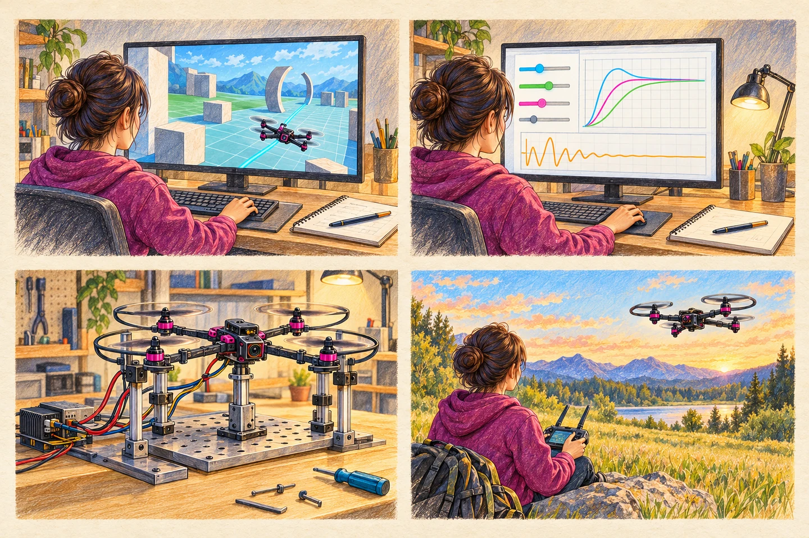
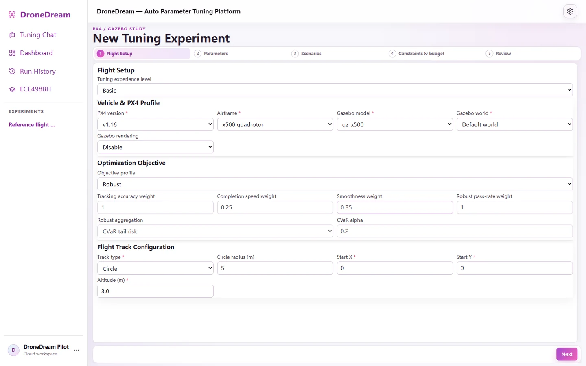
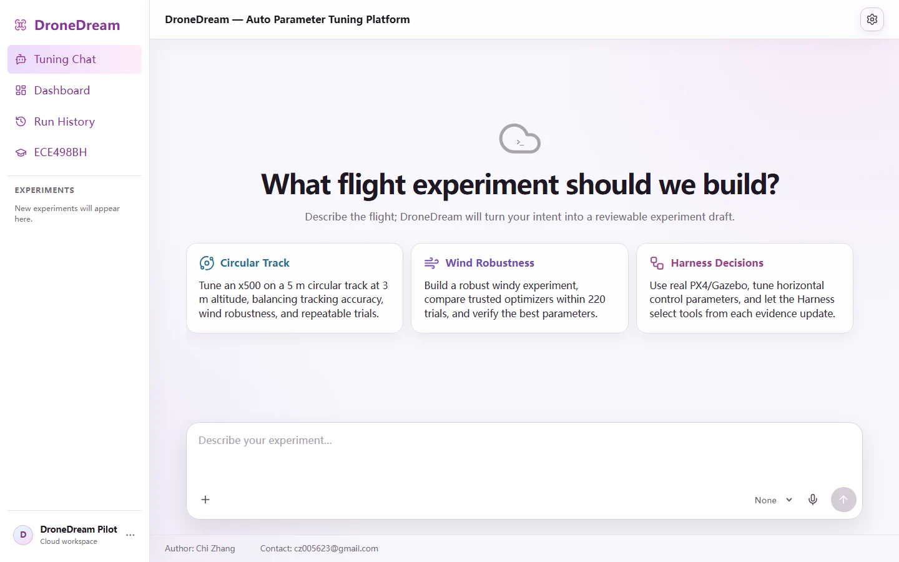
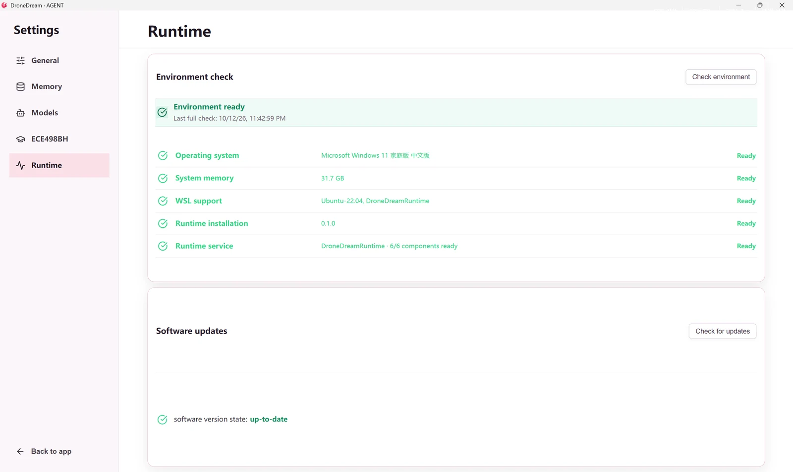

# 1. The Big Picture

At 8:20 on a bright campus morning, the clinic calls the robotics lab. A sealed sample must cross the grounds before the next class begins. The operator does not start by opening five tools or typing coordinates. She opens DroneDream and begins with the outcome: collect the package, fly it to the lab, then return to the clinic lawn.

DroneDream is the place where that single intention stays connected. The map, aircraft, payload, simulation, tuning work, live mission, and local Runtime belong to one project, so the story does not break each time the work moves to a new stage.

## 1.1 Why DroneDream

Drone work often begins as a simple sentence and quickly fragments into map tabs, vehicle consoles, parameter files, simulator windows, and handwritten notes. Each tool may be useful, yet the operator must repeatedly rebuild the same context: which aircraft, which route, which settings, and which result.

DroneDream was created to keep those decisions together. It turns an ordinary goal into a visible sequence, carries shared project details from one workspace to the next, and gives the operator a clear place to understand what the aircraft is doing.

> **The promise.** Begin with the mission, keep every stage connected, and finish with a flight you can understand and repeat.

The operator remains in charge. DroneDream helps translate intent, prepare the workspace, and present the next useful choice. It does not hide the route, aircraft, or mission state behind the conversation.

## 1.2 Five Workspaces

The five products are different doors into the same building. Choose the door that matches today’s work; the project behind it remains familiar.

- **Universal** keeps the whole journey in view.
- **SIM** rehearses complete flights in virtual worlds.
- **LAB** joins software with controlled test hardware.
- **FIELD** prepares and follows operational aircraft.
- **AGENT** turns everyday language into missions.

Universal is useful when a project moves between several stages. The focused products keep one stage calm and uncluttered. All five share the same account, aircraft, maps, projects, and local Runtime.

## 1.3 One Shared Story

The clinic mission can move through DroneDream without being rewritten at every handoff:

1. Describe the delivery in AGENT, then confirm its destination, payload, aircraft, and return point.
2. Rehearse the same route in SIM, watching turns, altitude changes, timing, and final landing.
3. Refine motion in SIM and LAB, then keep the chosen setup with the project.
4. Open FIELD for the real aircraft, follow live state, and complete the same mission outdoors.

Each stage adds understanding. None of them erases the decisions made earlier. That continuity is the heart of DroneDream: one goal becomes one connected flight story.

---

# 2. Flight Agent

The Flight Agent is the first character the operator meets. It listens for intent, gathers the map and aircraft already selected, and turns an everyday request into a mission that can be read before it is flown.

Imagine the clinic mission again. The operator knows the two buildings, the package, and the desired return point. The Agent’s job is to connect those facts without forcing her to speak like a command line.

## 2.1 Say the Goal

Begin with the result you want. Include the place, the task, and any detail that changes the flight. Natural building names are better than a pile of raw coordinates when the selected map already knows those places.

> **Example request.** Collect the sealed sample from Campus Clinic, deliver it to Robotics Lab, avoid the central courtyard, and return to the clinic lawn.

The request is short, but it carries a complete narrative: an origin, a payload, a destination, a route preference, and a final home point. If a detail is missing, add it in the next message instead of rebuilding the mission from the beginning.

The workspace keeps the active aircraft and map beside the conversation. Before sending the request, glance at those selections. A beautifully written mission still needs the right world beneath it.

## 2.2 Choose the Map

A map gives names a physical home. Choose the campus, facility, or operating area that contains the locations in the request. DroneDream can then connect “Campus Clinic” and “Robotics Lab” to real places instead of treating them as loose words.

Open the map once and read it like the first page of an atlas. Find the takeoff area, destination, narrow passages, tall structures, and safe landing space. The map should answer three questions before planning begins: where the aircraft starts, where the work happens, and where it finishes.

When a location name could mean two places, make the wording more specific. “North loading entrance” is more useful than “the door,” and “clinic lawn” is clearer than “outside.”

## 2.3 Ready the Aircraft

Next, choose an aircraft that can carry the mission. Its configuration should match the map, route, payload, and expected flight time. A small delivery drone may fit the campus story; a heavier inspection aircraft may suit a bridge or industrial site.

Before the plan leaves the page, check the few details that change everything:

- Camera clear and payload latch closed.
- Battery sufficient for route and reserve.
- Home point placed on open ground.
- Link and positioning show healthy status.

The payload belongs to the mission, not as an afterthought. Describe what is carried, where it is collected, and when it is considered secure. The live view can then keep that state visible during pickup, travel, delivery, and return.

## 2.4 Shape the Route

The Agent links the named places into a flight path. The route should feel like a sentence with good punctuation: longer straight segments carry momentum, while corners, approaches, and landing areas invite a slower pace.

DroneDream reduces speed progressively before turns and close work. It does not need to stop at every tiny deviation. When the path remains recoverable, the aircraft continues, corrects smoothly, and preserves the rhythm of the mission.

Read the route before starting. Follow it from the home point to the destination with your eyes. Check that it respects the intended corridor, approaches the work from a sensible direction, and leaves room for the return.

## 2.5 Follow the Flight

Starting the mission changes the page from planning to observation. Position, altitude, speed, route progress, payload state, and camera views now tell the story together.

Do not chase every moving number. Watch for meaningful changes. The aircraft should leave home, settle into cruise, slow before the destination, complete the requested work, and begin its return. The map explains where it is; the mission state explains why it is there.

The live view can switch between the 2D route and available visual feeds. Use the 2D view to understand progress across the whole map. Use a camera view when the task depends on approach, alignment, pickup, inspection, or landing detail.

## 2.6 Come Home

A delivery is not complete when the package reaches the lab. It is complete when the aircraft has finished the work, returned to its selected home point, landed, and reported a final state.

The ending should be calm and unambiguous:

1. Confirm the requested work is complete.
2. Watch the return route and descent.
3. Confirm landing and final mission status.

The completed project remains useful. Tomorrow’s mission can reuse the same campus, aircraft, and destination while changing only the payload or timing. A successful flight becomes the opening page of the next one.

---

# 3. Build and Fly

A good field flight is prepared long before the propellers turn outdoors. DroneDream lets the same project travel through simulation, tuning, controlled hardware, and live operation while its purpose remains recognizable.

Think of this chapter as the workshop behind the clinic delivery. Here the route is rehearsed, the motion is shaped, hardware is introduced, and Runtime keeps the local tools ready.

## 3.1 Pick a Workspace

Start from the question you need to answer.

Use **SIM** when the question is about virtual flight behavior. Use **LAB** when sensors, controllers, or test hardware enter the scene. Use **FIELD** when an operational aircraft is connected. Use **AGENT** when the mission should begin in everyday language. Use **Universal** when the project needs several of these views together.

The choice changes the tools in front of you, not the identity of the project. Maps, aircraft, mission context, and Runtime stay connected across the product family.

## 3.2 Rehearse in SIM

Simulation is the rehearsal room. Choose the PX4 version, airframe, Gazebo vehicle, world, route, and environment that resemble the real question. A useful rehearsal does not need to imitate every leaf and wall; it must preserve the conditions that matter to the mission.

For the clinic route, preserve the takeoff, long crossing, destination approach, payload pause, return, and landing. Add wind or payload only when they help answer a real question. Then run the complete story from departure to touchdown.

A repeated scenario is more valuable than a dramatic one. Keep the route and conditions stable while changing one meaningful choice, so the result remains easy to interpret.

## 3.3 Tune the Motion

Tuning shapes how the aircraft follows the route. Select parameters connected to the behavior you want to improve, give them physically meaningful ranges, and choose measures that reflect the mission.

For a campus delivery, the goal might be a brisk cruise with gentle approaches. That suggests balancing tracking, speed, smoothness, and settling near the destination. A single score is less useful than a motion you can explain.

Work in small, readable steps:

1. Name the behavior that feels wrong.
2. Choose parameters that can change it.
3. Compare candidates on the same route.
4. Keep the setting that improves the mission.

The chosen setup should leave a clear reason behind it: the aircraft turns more smoothly, reaches the destination with less overshoot, or holds the route more consistently.

## 3.4 Meet the Hardware

LAB is where the virtual story meets physical parts. Connect the sensors, controllers, and test equipment needed for the project, then make sure their timing, units, streams, and calibration agree.

The first goal is not spectacle. It is familiarity. A sensor value should mean the same thing in the model and on the bench. A command should travel through the expected path. A saved configuration should reopen with the same connections.

Move through the bench in a steady order:

- Connect one device at a time.
- Confirm units, timing, and calibration.
- Compare measured and modeled behavior.
- Save the working project configuration.

When LAB behaves predictably, FIELD begins with fewer mysteries.

## 3.5 Fly in the Field

FIELD gathers the operational aircraft, live telemetry, mission controls, and current state into one focused view. Before takeoff, confirm the aircraft identity, connection, position, battery, home point, and operating area.

Bring the same calm rhythm used in simulation. Read the mission from start to finish, make sure the surroundings match the map, and keep the live state visible through landing. If the environment has changed, revise the plan before the aircraft leaves the ground.

During flight, watch the mission rather than hunting through panels. Position, speed, altitude, payload, and return state should explain the next action at a glance.

## 3.6 Keep Runtime Ready

DroneDream Runtime supplies the local services behind PX4, Gazebo, mission execution, and project work. Install it through DroneDream, let the application manage it, and keep its storage separate from source files and ordinary documents.

The Runtime page should read like a quiet preflight board. Green states mean the environment is ready. If something is missing, run the environment check and follow the item that needs attention before returning to the mission.

A simple routine keeps the workshop dependable:

- Keep the Runtime installation drive available.
- Let preparation finish before launching workspaces.
- Recheck the environment after system changes.
- Update Runtime through DroneDream when offered.

With Runtime ready, the story closes where it began: an operator states a useful goal, DroneDream carries it through the right tools, and the aircraft completes work that can be understood, repeated, and improved.
